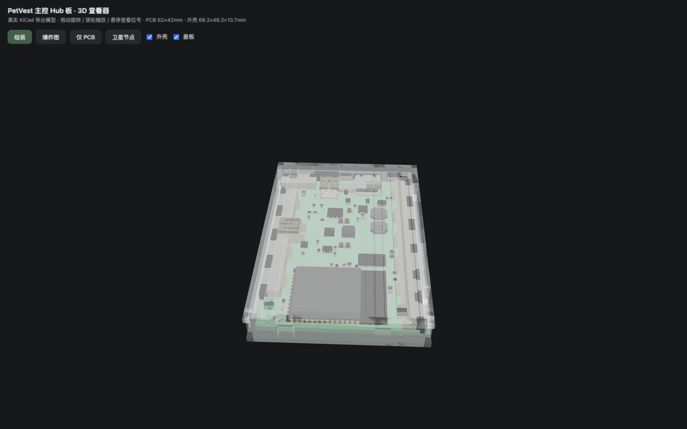
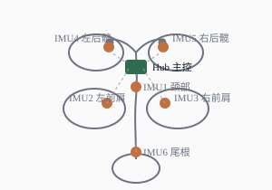
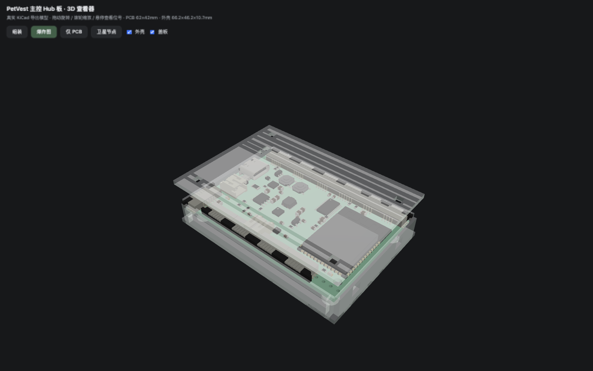
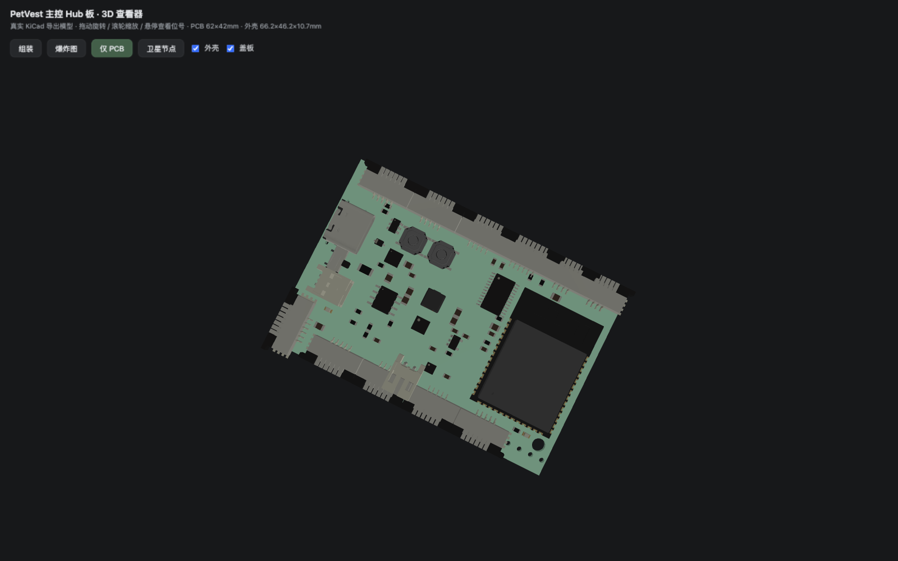
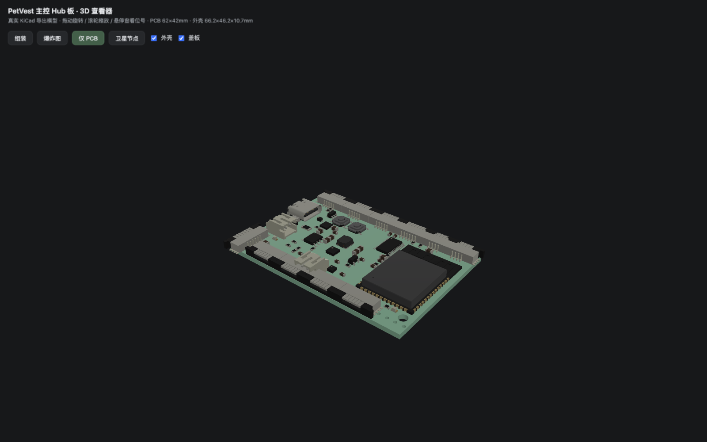
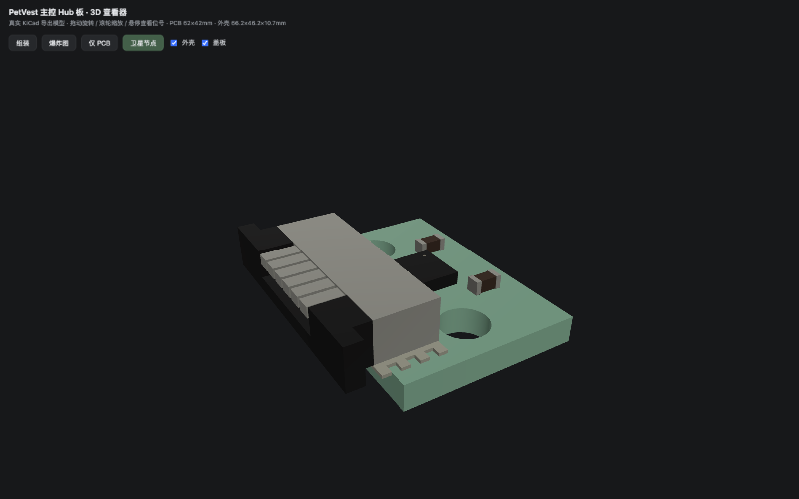
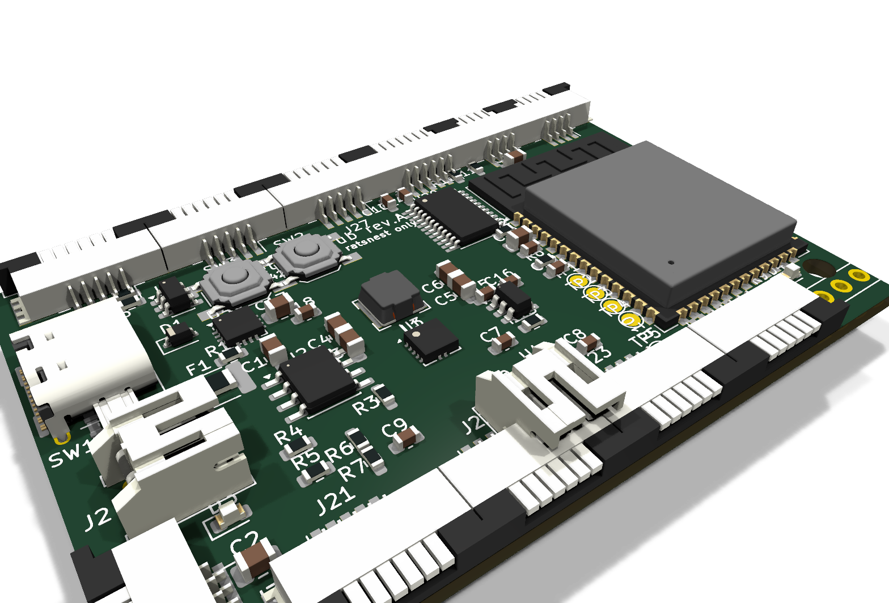
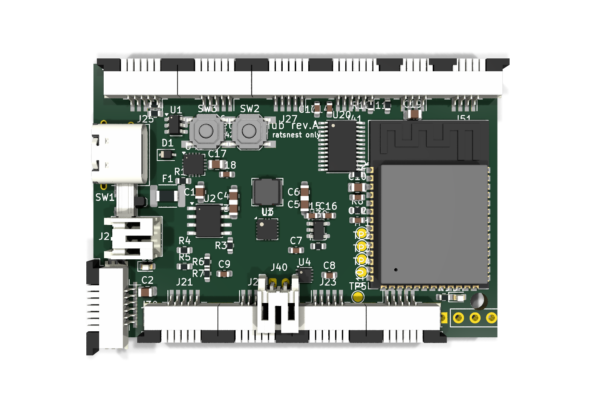
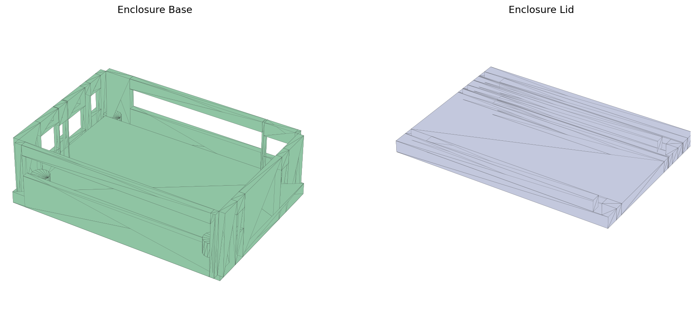

# PETA CUSTOM 🐕

**基于多传感器的宠物智能服装方案** — 6 轴姿态捕捉 · 心率血氧 · GNSS 定位 · I2S 语音交互 · OLED 显示,一体化 KiCad 10 硬件设计。



| | |
|---|---|
| **主控** | ESP32-S3-WROOM-1-N8R8(WiFi + BLE + 原生 USB) |
| **姿态** | 6× LSM6DS3TR-C 六轴 IMU(分布式卫星节点) |
| **健康** | MAX30102 心率血氧探头 + MAX17048 电量计 |
| **定位** | GNSS 模块接口(NEO-6M / ATGM336H 级) |
| **语音** | INMP441 I2S 麦克风 + MAX98357A D类功放 |
| **显示** | 0.96" SSD1306 OLED |
| **电源** | 1S 4000mAh 锂电 · TP4056 1A 充电 · TPS63061 buck-boost |
| **续航** | ≥18h(全天在线约 25h,休眠策略 40h+) |
| **工具链** | KiCad 10 · 原理图/PCB/3D 全流程脚本化生成 |

---

## 1. 项目背景

运动量不足、异常行为与走失,是城市宠物犬的三大痛点。市面上的"宠物智能项圈"只能记录活动量,
无法回答更专业的问题:

- **姿态与步态**:跛行、关节炎早期、术后康复评估,需要关节级别的运动学数据;
- **生理状态**:应激、中暑、疼痛会反映在心率与呼吸模式上;
- **位置安全**:遛狗脱离视线后的实时定位。

PETA CUSTOM 采用**服装形态**而非项圈形态:IMU 传感器沿犬体脊柱与四肢根部分布式布置
(见 [穿戴位置示意](docs/img/dog-placement.svg)),才能获得躯干/四肢分段姿态——这是单一项圈
设备在物理上无法实现的。主板(Hub)集成电源、主控、语音与显示,通过软排线连接 6 个缝在服装
上的 IMU 卫星节点,整机重量与柔性针对犬类穿戴优化。

> ⚠ 本仓库目前为**硬件 v1.0 工程阶段**:原理图/PCB/3D/外壳已闭环并通过机器校验,
> 尚未打样。欢迎 issue 交流。

## 2. 系统架构

```
                      ┌────────── 1S 4000mAh 锂电(带PCM保护板) ──────────┐
                      │                                                  │
 USB-C 5V ──PTC 2A──TVS                                                  │
   │        └─► TP4056 1A ─┘─► 电源开关 ─► TPS63061 buck-boost ──► 3.3V/1.2A
   │                                                          │
 ESP32-S3-WROOM-1-N8R8 ◄── USB D+/D-(USBLC6 ESD) ── USB-C
   │ I2C0 ──┬── TCA9548A 8ch 复用 ──┬─ CH0..CH5 ──► 6× FPC ──► IMU 卫星节点 ×6
   │        │                      └─ CH7 ────► 预留扩展
   │        ├── MAX17048 电量计(0x36)
   │        ├── OLED SSD1306(0x3C, FPC-4)
   │        └── MAX30102 心率探头(FPC-6, 1.8V 板载 LDO)
   │ I2S1 ◄── INMP441 麦克风(卫星)   I2S0 ──► MAX98357A ──► 8Ω2W 喇叭
   │ UART1 ──► GNSS 模块(FPC-4)
   └ ADC ◄── 电池分压
```

**为什么是 Hub + 卫星节点?** 犬体是曲面,IMU 必须贴着颈/肩/髋/尾的皮肤。主板上只放
TCA9548A 复用器和 FPC 座,每颗 IMU 是独立的 14×10mm 小软板(含 2 颗缝纫孔),通过
≤30cm 软排线以 400kHz I2C 接入——同型号 IMU 的地址冲突也被复用器一并解决。

<p align="center"></p>

## 3. 功能特性

| 模块 | 方案 | 说明 |
|---|---|---|
| 姿态捕捉 | 6× LSM6DS3TR-C @ 104Hz | 颈/双肩/双髋/尾根分段姿态,支持步态与行为识别 |
| 心率血氧 | MAX30102 探头 | 1.8V 由主板供给,开漏 INT,建议贴耳廓内侧 |
| 定位 | GNSS 卫星模块 | 天线朝天布置于背带上方,远离主控天线 |
| 语音交互 | INMP441 + MAX98357A | 双 I2S 全双工;功放由电池直供保证音量,默认关断 |
| 显示 | SSD1306 0.96" | 胸前 OELD,与传感器共 I2C 总线 |
| 电源管理 | MAX17048 + ADC 双保险 | 精确 SOC + 分压兜底;充电/充满双 LED |
| 扩展 | TCA9548A CH7 预留 | 第 7 通道 FPC 座已布置,可加温度/气压等传感器 |

## 4. 仓库结构

```
peta-custom/
├── README.md
├── docs/
│   ├── img/                      # 全部展示图(3D截图/渲染图/示意图)
│   ├── schematic-svg/            # 主控板原理图(SVG 矢量)
│   ├── schematic-svg-node/       # IMU 节点原理图
│   ├── petvest-hub-schematic.pdf # 原理图 PDF(6 张分层图纸)
│   └── petvest-imu-node-schematic.pdf
├── kicad/
│   ├── petvest-hub/              # 主控 Hub 板 KiCad 10 工程
│   │   ├── petvest-hub.kicad_sch #   根原理图 + 6 张分图
│   │   ├── petvest-hub.kicad_pcb #   62×42mm 布局(70 封装已放置)
│   │   ├── petvest.kicad_sym     #   自定义符号库(MAX17048)
│   │   └── preview/              #   原理图 PDF + 3D 渲染图
│   └── petvest-imu-node/         # IMU 卫星节点工程(14×10mm, 打 6 片)
├── 3d/
│   ├── petvest-hub.glb / .step   # 整机 3D 模型(GLB 预览 / STEP 进 CAD)
│   ├── petvest-imu-node.glb / .step
│   ├── petvest-hub-外壳底壳.stl   # 3D 打印外壳(直接切片)
│   ├── petvest-hub-外壳盖板.stl
│   ├── viewer.html               # ★ 离线 3D 展示页(双击打开, 见 §5)
│   └── libs/                     # viewer 的本地 three.js 运行库
├── bom/
│   ├── bom-petvest-hub.csv       # 主板 BOM(含推荐型号)
│   ├── bom-petvest-imu-node.csv  # 节点 BOM(×6)
│   ├── netlist-petvest-hub.csv   # 64 网络连接表
│   └── pinmap-esp32s3.csv        # ESP32-S3 引脚分配表
└── tools/                        # 全流程生成脚本(改需求 → 重跑)
    ├── gen_schematic.py          #   原理图生成器
    ├── gen_pcb.py                #   PCB 布局生成器
    ├── gen_enclosure.py          #   外壳 STL 生成器
    ├── gen_viewer.py             #   3D 展示页生成器
    ├── gen_bom.py                #   BOM/引脚表导出
    └── check_netlist.py          #   网表交叉校验
```

## 5. 3D 展示页 ⭐

仓库自带**零依赖离线展示页**——双击 [`3d/viewer.html`](3d/viewer.html) 即可在浏览器打开
(需保留 `3d/libs/` 目录;加载的是 KiCad 导出的真实 GLB 模型,非示意图):

| 视图 | 内容 |
|---|---|
| 组装 | 外壳 + PCB + 全部元件的真实装配状态 |
| 爆炸图 | 盖板抬升 / PCB 悬浮,检查内部结构 |
| 仅 PCB | 裸板多角度检查 |
| 卫星节点 | 14×10mm IMU 节点(含缝纫孔) |

悬停任意元件显示**位号与中文说明**(数据来自 KiCad 工程)。

**装配视图**(外壳开口与板边接口一一对应):


**爆炸图**(盖板 / PCB / 底壳三层):



**仅 PCB**(俯视 + 等轴测):

<p>
  
  
</p>

**IMU 卫星节点**(14×10mm,Ø2.7 缝纫孔 ×2):



## 6. KiCad 光线追踪渲染

<table>
  <tr>
    <td></td>
  </tr>
  <tr>
    <td align="center"><sub>主控 Hub 板 · KiCad 10 光线追踪(元件 3D 模型来自官方库)</sub></td>
  </tr>
  <tr>
    <td></td>
  </tr>
</table>

## 7. 原理图

- 主控 Hub 板(6 张分图):[SVG 矢量](docs/schematic-svg/petvest-hub.svg) · [PDF](docs/petvest-hub-schematic.pdf)
- IMU 节点:[SVG](docs/schematic-svg-node/petvest-imu-node.svg) · [PDF](docs/petvest-imu-node-schematic.pdf)

## 8. 3D 打印外壳

底壳 66.2×46.2×10.7mm,所有开口与板边接口一一对应:
左壁 = USB-C / 电源开关拨嘴 / 电池出线 / 心率探头 FPC;顶壁 = 6×FPC 排线槽;
底壁 = 4×FPC 排线槽 + 织带缝合槽;右壁 = 2×织带缝合槽;盖板 = 4×M2.5 自攻柱 + 2×LED 透光孔。



打印建议:0.2mm 层厚 · 壁厚 ≥1.8mm(4 圈)· PETG 或 TPU;**切片时多实体请勾选"合并/Union"**。

## 9. 快速开始

```bash
# 打开硬件工程(KiCad 10)
open kicad/petvest-hub/petvest-hub.kicad_pro

# 查看 3D(双击或)
open 3d/viewer.html

# 修改需求后一键重建(原理图 → PCB → 外壳 → BOM → 展示页)
python3 tools/gen_schematic.py && python3 tools/gen_pcb.py
python3 tools/gen_enclosure.py && python3 tools/gen_bom.py && python3 tools/gen_viewer.py
```

生成器已内置校验:原理图导出网表与模型逐节点比对 PASS;PCB 生成含"原理图元件必须全部有封装"断言。

## 10. 路线图

- [x] v1.0 原理图(7 张分层图纸, 网表机器校验通过)
- [x] v1.0 PCB 布局(70 封装, 鼠线待布)
- [x] 3D 模型 + 打印外壳
- [x] 离线 3D 展示页
- [ ] 铜线布线 + DRC(下一版)
- [ ] MAX30102 心率探头小板(犬类 PPG 预研)
- [ ] 固件框架(ESP-IDF: 采样/融合/上报)
- [ ] 打样与犬类实测

## 11. 工程注意事项

1. **犬类心率**:毛发遮挡强,反射式 PPG 务必先做耳廓内侧信号质量预研;
2. **电池安全**:必须使用带 PCM 保护板的电芯(主板未画保护电路);
3. **天线**:ESP32 天线区净空 ≥8mm,GNSS 天线远离功放与 USB;
4. MAX17048/TP4056 封装 EP 尺寸请对照实际采购批次 datasheet 复核。
